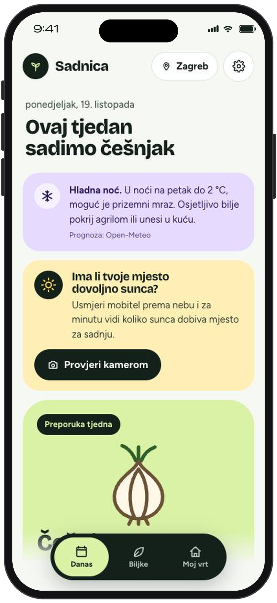
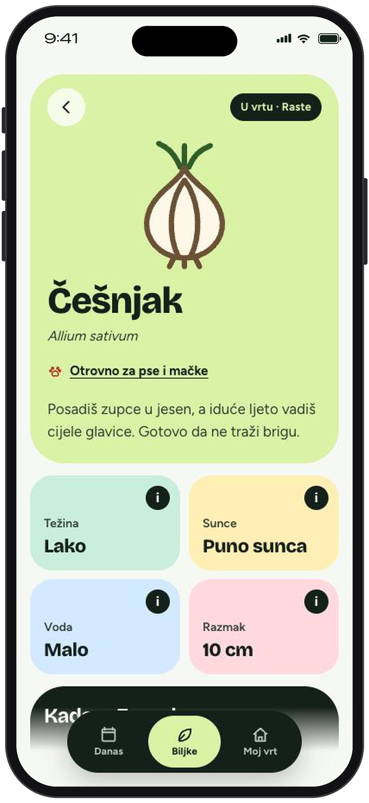
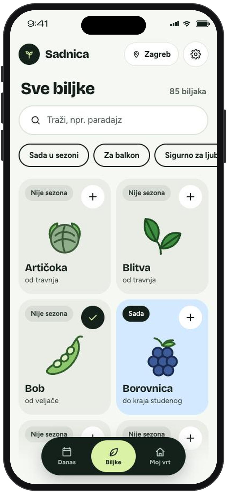

# Sadnica

Aplikacija za početnike u vrtlarenju: što posaditi ovaj tjedan tamo gdje živiš, i kako. Sučelje je
na hrvatskom, radi bez računa i bez interneta, a sve što upišeš ostaje samo na tvom uređaju.
"Sadnica" je radni naziv (`src/lib/config.ts`).

<p>
  
  
  
</p>

## Što aplikacija radi

- **Danas**: preporuka tjedna za tvoje mjesto i doba godine, što još stigneš posaditi i što dolazi
  uskoro. Upozorava na mraz prema stvarnoj prognozi (Open-Meteo).
- **Biljke**: katalog od 85 biljaka (povrće, začinsko bilje, voće, cvijeće) s pretragom i filtrima,
  među njima "Za balkon", "Lako za početnike" i "Sigurno za ljubimce".
- **Stranica biljke**: kada sijati i brati u tvojoj regiji, koraci sadnje, česti problemi, dobri i
  loši susjedi te upozorenje ako je biljka otrovna za pse i mačke.
- **Razmak i dubina**: animirani crtež sadnje, odozgo i sa strane, izrađen iz podataka svake biljke.
- **Moj vrt**: biljke u tvom vrtu, s fazama (posijano, raste, spremno), datumima,
  kalendarom, bilješkama i zapisom berbe.
- **Provjera sunca**: kamerom mobitela izmjeri koliko sunca dobiva mjesto za sadnju.
- **Postavke**: prijenos vrta na drugi uređaj (QR kod ili poveznica) i sigurnosna kopija u datoteku.

Aplikacija razlikuje dvije klimatske regije, kontinentalnu i jadransku, prema mjestu koje odabereš.

## Pokretanje

```bash
npm install
npm run dev        # http://localhost:5173
npm run dev:phone  # https na lokalnoj mreži, za provjeru sunca kamerom na mobitelu
npm test           # testovi (sezone, pretraga, zadaci, spremanje, crteži sadnje)
npm run validate   # provjera sadržaja u data/ prema shemi
npm run build      # provjera sadržaja, zatim statična stranica u build/
npm run preview    # posluži build/ lokalno
npm run check      # provjera tipova
npm run icons      # ponovno izradi ikone u static/icons
```

Rezultat izgradnje je statična stranica (SvelteKit s adapter-static), pa se može postaviti na bilo
koji statični hosting.

## Struktura

| Putanja | Što je |
| --- | --- |
| `data/plants/*.json` | Jedna datoteka po biljci. Novu biljku dodaješ novom datotekom, ništa drugo ne treba mijenjati. |
| `data/explanations.json` | Tekstovi za objašnjenja Težina, Sunce i Voda. |
| `data/rules.json` | Datumi mraza po regijama i pravila za sezone. |
| `src/lib/data/schema.ts` | Zod shema za sav sadržaj. `scripts/validate-data.ts` zaustavlja izgradnju ako podaci nisu ispravni. |
| `src/lib/season.ts` | Je li biljka u sezoni i redoslijed preporuka. |
| `src/lib/planting/` | Geometrija, tekstovi i animacija crteža sadnje. |
| `src/lib/i18n/hr.ts` | Svi tekstovi sučelja. |
| `src/lib/storage.ts`, `store.svelte.ts` | Stanje spremljeno u pregledniku (localStorage), s verzijom. |
| `src/routes/` | `/` Danas, `/pocetak`, `/biljke`, `/biljke/[id]`, `/moj-vrt`, `/sunce`, `/postavke`. |
| `src/service-worker/` | Rad bez interneta. |
| `docs/decisions.md` | Odluke donesene tamo gdje specifikacija nije ništa rekla (na engleskom). |
| `docs/content-review.md` | Vodič za stručni pregled sadržaja (na engleskom). |

## Stanje sadržaja

Sav vrtlarski sadržaj (85 biljaka, datumi, razmaci, savjeti, otrovnost za ljubimce) napisan je bez
stručnjaka i označen s `"reviewed": false`. Prošao je tri automatska čitanja, ali prije objave ga
mora provjeriti osoba koja se razumije u vrtlarstvo. `npm run validate` ispisuje koliko je datoteka
još nepregledano, a `docs/content-review.md` objašnjava što treba provjeriti.
